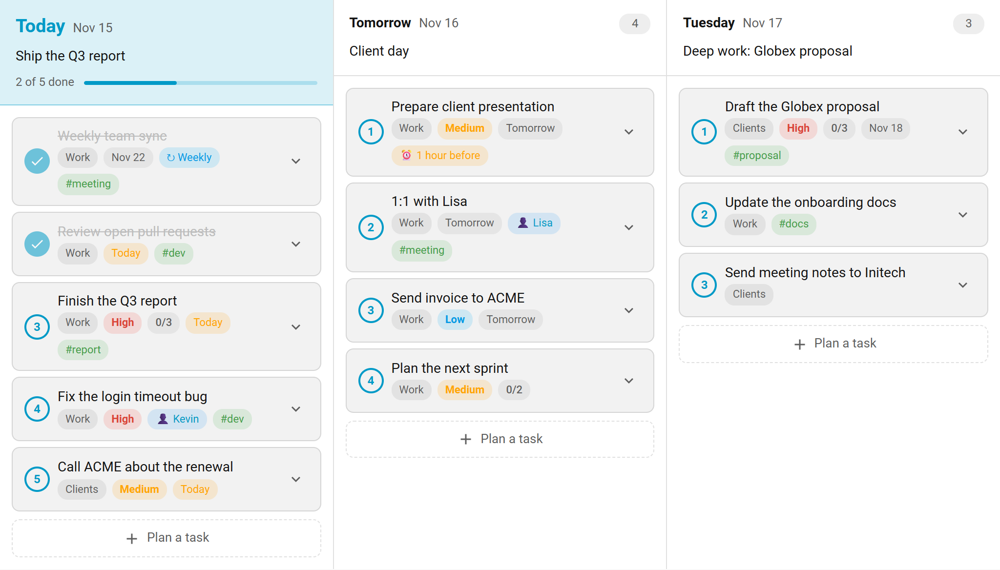

## v3.0.1

A different view: **day plans**. Plan across your lists which task gets done on which day, with its own dashboard card, services and assistant tools. Also new: one card can show each person their own tasks, and a column can appear only under conditions, as a card's own Visibility tab sets them. AI assistants can work with your lists and plans, recurring tasks can come back as soon as they are ticked off, a native list's to-do entity can follow the card's sort orders, and each list and plan is now a service in Home Assistant, which suggests the cards when you add a card by entity. Linked lists keep a task's data when the provider gives it a new ID, and the card editor's title fields are back on Home Assistant 2026.11.

---

### 🗓️ Highlight: Day plans

A day plan sets out which tasks are meant for which day, and in what order, across native and linked lists. Tasks stay in their lists: the plan only puts them on a day.

- **Day plans**: a new kind of entry ("Create a day plan"). A day shows what you planned and what is due on it. A linked task ticked off in its provider's app stays on its day as done, even with no card open. Settings cover the lists a plan uses, its workdays (any days from Monday to Sunday, for a part-time week too), and carrying over what was left open.
- **Day plan card** (`custom:home-tasks-day-plan-card`, "Home Tasks: Day plan"): today and the days after it side by side, each with a focus note, and today's progress. Tap a row's number to tick it off, drag rows to reorder or re-plan, plan tasks with a search across the plan's lists, and open the same task details as in the list.
- **Plan for…**: in the list card, a task of a list that a plan uses can be put on a day straight from its details.
- **Day plan services**: `get_day_plan`, `set_day_plan`, `plan_task` and `unplan_task`. `get_tasks` can now read several lists at once.
- **A sensor per plan** with the open items of the current day.

Elsewhere in these notes, 🗓️ marks what belongs to day plans as well.

---

### New Features

- **A card per person, in one card**: a column's *Limit to people* filter has a new **Current user** chip, so the column shows the tasks of whoever is signed in (with *Unassigned*, theirs and the unclaimed ones). The same chip is among a list's default assignees, under *Defaults*: new tasks then go to whoever adds them, from the card, a service call or an assistant. A column can also be shown only under conditions: the card editor has a *Visibility* section with Home Assistant's own Visibility editor, so it works like a card's Visibility tab: users, screen, time, location, state, numeric state, template, sun, zone, device and view columns, combined with and, or and not. State, template, sun and the other conditions Home Assistant itself judges for a card, it judges for a column too. While the dashboard is edited, hidden columns show dimmed. With one column left, the card looks like a card of one column; with none, it hides. This tidies what each person sees; it is not access control.
- **Lists and plans in *Devices & services*** 🗓️: each list, linked list and plan is a service that holds its entities together. Put a list in an area there, and its entities are in it. An area you gave a list's entities moves to its service once, on the update: the to-do entity's area, else the one most of its entities share. Entity names and IDs stay as they were.
- **Card suggestions** 🗓️: when you add a card by entity, Home Assistant offers the list card for any entity of a list (also a provider's to-do entity linked to Home Tasks) and the day plan card for a plan's *Open Items* sensor.
- **Tools for AI assistants** 🗓️: conversation agents and Home Assistant's MCP Server can now do with your lists what you can in the cards: read, add, change, complete, move, duplicate, order and delete tasks and sub-tasks, keep sections and list defaults, and fill day plans. One set, **Home Tasks**, reaches everything; each day plan also has its own set that reaches only that plan's lists. Nothing is reachable until you hand a set to an assistant.
- **Reopen recurring tasks right away**: a list setting under *Defaults* in the card editor, for native and linked lists. A ticked-off recurring task comes back half a minute later, already due on its next occurrence, instead of waiting as done until then. The half minute leaves time to untick a tick made by mistake. Switching it on also brings back the tasks still waiting, and the reopen lead is hidden while it is on. Lists whose provider runs the recurrence itself, such as Todoist, don't have it (#90, thanks @PikaYellow35).
- **Order of the to-do entity**: a native list's `todo` entity, which Home Assistant's to-do page, the companion app and Assist show, can follow the card's sort orders: manual, due date, priority, title or person. It is set in the card editor under *Defaults*. Items can be moved there only in manual order (#90, thanks @PikaYellow35).
- **Unassigned in a column's people filter**: a column's preset filter can show the tasks nobody is assigned to, alone or together with named people. New tasks in such a column stay unassigned (#93, thanks @chrisjrhodes).
- **`task_reopened` events** 🗓️ now say whether the recurrence reopened the task (`reopened_by`), so a day plan can tell that from an untick.
- **Create a list or plan from the editor** 🗓️: for administrators, the card editors link to the Home Tasks settings page.

### Bug Fixes

- **Card editor on Home Assistant 2026.11**: the card title and column title fields were missing; they are back.
- **Bring! renames** 🗓️: renaming an item now keeps what Home Tasks stores for it: tags, reminders, recurrence and its place on a day plan.
- **Errors from linked lists**: the card shows the provider's own error message instead of "an internal error".
- **Todoist**: a linked list whose project can't be found now reads as empty and is retried every five minutes. Before, it showed the whole account and created new tasks in the Inbox.
- **Recurring tasks of linked lists**: a task that repeats counted from its completion now comes back due on its next occurrence. Before, it came back already overdue.
- **Drag & drop in multi-column lists**: dragging takes the row from the column the drag started in.

### Documentation

- **README** 🗓️: the two cards, day plans, plan services, a new section on AI assistants, a new section on showing a column under conditions, lists and plans as services, the two new list defaults and a new screenshot.

**Full Changelog**: https://github.com/L3t4l3s/home-tasks/compare/v2.5.3...v3.0.1
